# DME Coordination Agent — Architecture (v3)

Take-home for Mira Mace: automate DME back-end coordination for Eleanor Martinez
(72, Original Medicare Part B, no Medigap) who needs a standard manual wheelchair (HCPCS K0001).

**Principle: AI owns the conversations. Code owns the commitments.**

- Eleanor talks to a **companion agent** — warm, patient, remembers her. It is the *voice* of the case, not its owner.
- A **deterministic core** owns the case: every open item has a state, an owner ("who holds the ball") and a due time.
- **Outbound voice agents** do one bounded task each (call the PCP, call a supplier) and exit.
- The LLM proposes facts with evidence; deterministic rules move state.

The PCP order (and the medical-necessity documentation behind it) is the critical path and the
main claim risk, so that leg is built deep and real. The supplier leg is broad but thin.

Source: [`architecture.mmd`](architecture.mmd)

---

## 1. Three kinds of agents around one deterministic core

| Agent | Talks to | Lifetime | Job | May not |
|---|---|---|---|---|
| **Companion** | Eleanor (and caregiver) | Long-lived, many conversations, memory | Explain, reassure, answer "where's my chair?", collect consent/address, notice worry | Invent facts, promise dates/costs, change state, commit her to anything |
| **Outbound callers** | PCP front desk, suppliers | One task, then exit | Run a bounded call from a code-owned slot agenda; disclose AI | Change state, share PHI before identity is verified, commit on her behalf |
| **Extractor** | Transcripts | Per call / per note | Turn transcripts and visit notes into typed facts, each with a verbatim evidence quote | Decide anything |

## 2. Components

| Component | Kind | Responsibility |
|---|---|---|
| Orchestrator | Code | Event-sourced state machine; event → new state → next action. One case processed serially on a virtual clock |
| Triggers | Code | Timers, call results, **patient-initiated messages**, inbound faxes/callbacks, human resolutions |
| Case tracks | Code | Patient · Order · Supplier · Assignment · Delivery — each with `state, owner, due_at` |
| Rules engine | Code | Supplier eligibility, SWO completeness, LCD criteria pass/fail, K0001 / code drift, assignment |
| Commitment ledger | Code | Every promise `{party, what, due_at, status}`; owner ≠ us and due passed = silence → follow-up |
| Event log | Code (JSON) | Append-only source of truth; every transition cites a transcript span, timer, patient intent or human id |
| **Case snapshot** | Code (read model) | Plain-language projection of current state, owners, due dates, cost. The *only* fact source for the companion |
| **Patient profile** | Code (store) | Best contact times, caregiver, language/hearing needs, prior concerns |
| **Intent API** | Contract | Companion's only write path: `confirm_address`, `give_consent`, `ask_status`, `cost_concern`, `reschedule`, `needs_human` |
| **Notify policy** | Code | Decides *when* Eleanor hears something (which state changes, quiet hours, ≤ ~1 update/day). LLM decides *how* |
| **Grounding check** | Code | Before any message reaches Eleanor: every date, $ and name must appear in the snapshot, else regenerate/hold |
| Scheduler | Code | Business hours per counterparty, patient quiet hours, retry budgets |
| Escalation inbox | Code + human | Typed question + options + context; blocks one track; answer returns as `HUMAN_RESOLVED`. **Patient lane** → warm handoff to a nurse advocate |
| Counterparty sim | LLM (mocked telephony) | PCP front desk / supplier personas with a hidden fact sheet; reveal facts only when asked |

## 3. Where AI sits — and where it is kept out

**AI in (only where language is unavoidable)**
- Talking with Eleanor: empathy, plain-language explanation, noticing confusion or distress (companion).
- Conducting outbound phone calls (callers).
- Turning speech and visit notes into typed facts (extractor). Pass/fail stays a rule.

**AI out (deterministic, auditable)**
- State transitions, owners, due dates, timers, retries, failover, escalation triggers.
- Supplier eligibility, SWO completeness, K0001 / code-drift check, assignment check, which supplier to commit to.
- *When* to contact Eleanor, and every fact (date, cost, name) she is told.
- When PHI may enter a caller's context (only after code verifies who answered).

No agent has a tool that changes state. Companion writes typed intents; callers return transcripts; extractor returns claims. Code validates all of it.

> Why not let the companion run the case, since it already talks to her? Its job is trust. One invented date or wrong cost and Eleanor stops believing it. Improvisation belongs in the conversation, not in the commitments.

## 4. State model — who holds the ball

**Case:** `ACTIVE` · `PAUSED` (hospitalised — timers stop, leases released) · `CANCELLED` · `COVERAGE_CHANGED` · `DONE`

Every track carries `owner` (us · a named external party · Eleanor · a human advocate) and `due_at`.
Owner = us → act now. Owner = someone else → wait until due, then follow up. Owner = advocate → that track blocks; others continue.

**Patient track (gates the others)**
`INTAKE` (address, home layout, caregiver) → `CONSENTED` → `COST_DISCLOSED` → `COST_ACCEPTED` → … → `DELIVERY_CONFIRMED`
Side state: `CONCERN_RAISED` (cost / confusion / distress) → advocate lane

**Order track (critical path)**
`NOT_SENT` → `DRAFTED` (SWO pre-filled, visit note requested) → `DOCS_CHECK`
→ (`ADDENDUM_REQUESTED` → `DOCS_CHECK`) → `SIGNED` → `SENT_TO(sid)` → `RECEIVED_BY(sid)` → `VALID`
Blockers: `STALLED` · `BLOCKED_ON_HUMAN`

**Supplier track**
`CANDIDATES` → `CALLING(sid)` → `QUALIFIED(sid, facts, verified_at)` → `COMMITTED(sid, ref, expires_at)`
`COMMITTED` → lease lapse → `REVERIFY` → `COMMITTED` | `CANDIDATES`
Blockers: `EXHAUSTED` · `BLOCKED_ON_HUMAN`

**Assignment:** `UNKNOWN` → `CONFIRMED_ALL_MONTHS` | `REFUSED` (supplier ineligible)

**Delivery:** `SCHEDULING` (needs Eleanor's availability) → `SCHEDULED(date)` → `DELIVERED` → `POD_CONFIRMED` · `MISSED` → `SCHEDULING`

Coupling rule: the PCP sends the order **to the committed supplier**. A supplier switch emits `ORDER_REDIRECT`.

## 5. Invariants (asserted in code)

1. At most one supplier is `COMMITTED`. `SCHEDULED` ⇒ `order.received_by == committed.sid` ∧ order `VALID` with K0001 ∧ assignment confirmed ∧ `committed.verified_at` within 24h ∧ patient `COST_ACCEPTED`.
2. Liveness: every non-terminal case has ≥1 pending task or open escalation; terminal cases have none.
3. Every outbound action has an idempotency key `(case, party, intent, version)`; resend only after a verify step returned "not received".
4. Every transition traces to an event with a source (transcript span, timer, patient intent, human id). No LLM output mutates state directly.
5. Every message to Eleanor passes the grounding check; no outbound contact outside business hours / her quiet hours.

## 6. Escalation triggers (closed set)

**Case lane**
- Visit note missing an LCD criterion after one addendum request.
- PCP refuses, asks clinical questions, or order stalled after 24/48/72 business-hour follow-ups.
- HCPCS drifts from K0001 (K0002–K0007 need face-to-face + written order prior to delivery; K0005 prior auth).
- No supplier will accept assignment for all rental months, or all suppliers exhausted.
- Extraction check fails: missing evidence quote, contradiction, two-pass disagreement, failed readback.

**Patient lane (warm handoff to a nurse advocate)**
- Distress, clinical question, or "I want to talk to a person".
- Cost concern or dispute; any request to sign an ABN or pay out of pocket.
- Address / home access unknown or unsuitable; unreachable after 3 attempts + caregiver.

Each escalation shows: reason, what was tried, transcript / conversation snippets, 2–3 typed options, suggested next action.

## 7. Extraction and grounding safeguards (instead of self-reported confidence)

- Evidence quote per extracted field, verified by substring check — fails → field is `null`.
- Cross-field consistency rules (e.g. `in_stock=false` with `eta_days=2`).
- Readback on calls ("So to confirm: in stock, delivery Thursday, you accept assignment?").
- Two-pass extraction agreement; per-field `unknown` instead of a numeric confidence.
- Companion output: every date / $ / name must exist in the case snapshot.

## 8. Domain rules encoded

- **SWO elements:** beneficiary name/MBI, order date, item description (HCPCS/narrative), quantity, practitioner name/NPI, signature, separately billed accessories.
- **Medical necessity (LCD L33788):** mobility limitation impairing MRADLs in the home; cane/walker insufficient; home accommodates the chair; improves MRADLs and will be used; self-propel ability or willing caregiver.
- **Billing:** supplier must accept assignment every rental month; KX modifier only when all criteria met. The supplier bills Medicare — we make sure the claim *will* pass.
- **Cost:** price is set by Medicare, not quoted. 2026 Part B deductible $283; then 20% of the approved monthly rental, typically up to 13 months (capped rental), then owned.
- **PHI:** screening calls carry no PHI; name/DOB/MBI only after a supplier qualifies and identity is verified; nothing on voicemail.
- **Disclosure:** callers disclose AI on first turn and after every transfer; companion is clear it is Mira Mace's assistant and that a nurse is available.

## 9. Evaluation

**Case (orchestration + callers)**
- ~8 named scenarios (one per failure mode + happy path), each with a hidden fact sheet.
- Correct autonomous closes · **false closes (hard gate = 0)** · escalation precision/recall · per-field extraction accuracy · PHI-before-verification (0) · unauthorised commitments (0) · injection success · $ and advocate-minutes per case.
- Adversarial phone behaviours: IVR, voicemail/after-hours, hold → transfer, "call back after 2pm", partial answers, mid-call contradiction, wrong number, social engineering for DOB/MBI, prompt injection.

**Companion**
- Groundedness: invented dates/costs/names = 0.
- Intent detection accuracy ("I can't afford this" → `cost_concern`).
- Handoff recall: distress and clinical questions always reach a human.
- Tone rubric (clear, warm, no jargon), judged on a fixed conversation set.

## 10. Stack

Python · Pydantic · plain asyncio orchestrator · Claude/OpenAI structured outputs · JSON event log · `rich` CLI timeline + simple patient chat.
No LangGraph: there is no LLM-driven control flow. Transitions are pure functions over an event log, so Temporal is a drop-in durable runtime later.
Callers and companion share one contract (task/intent in, transcript/intents out), so real voice plugs into the same slot.

## 11. Cut list (3h box)

Real telephony/STT/TTS · claim submission · geocoding · persistence · PCP portal automation · multi-case scheduling · full HIPAA controls (designed for, not built) · long-term companion memory beyond the profile.

## 12. What's next

- **1 day:** real voice on the PCP leg and for the companion; hand-labelled extractor eval (~50 nasty utterances); companion groundedness/handoff eval; measured cost and latency per call.
- **2 weeks:** shadow mode beside advocates (agreement + advocate minutes saved) → supplier memory across cases (stock, assignment, responsiveness, ghosting) → multi-case scheduler with per-supplier batching. Measure before scaling; memory makes scaling cheap.

## 13. Verify before claiming in the defense

- K0001's exact capped-rental vs purchase category in the fee schedule.
- Face-to-face exemption for K0001 (checked on Noridian's list, not CGS).
- Whether DME suppliers are exempt from the limiting-charge cap.
