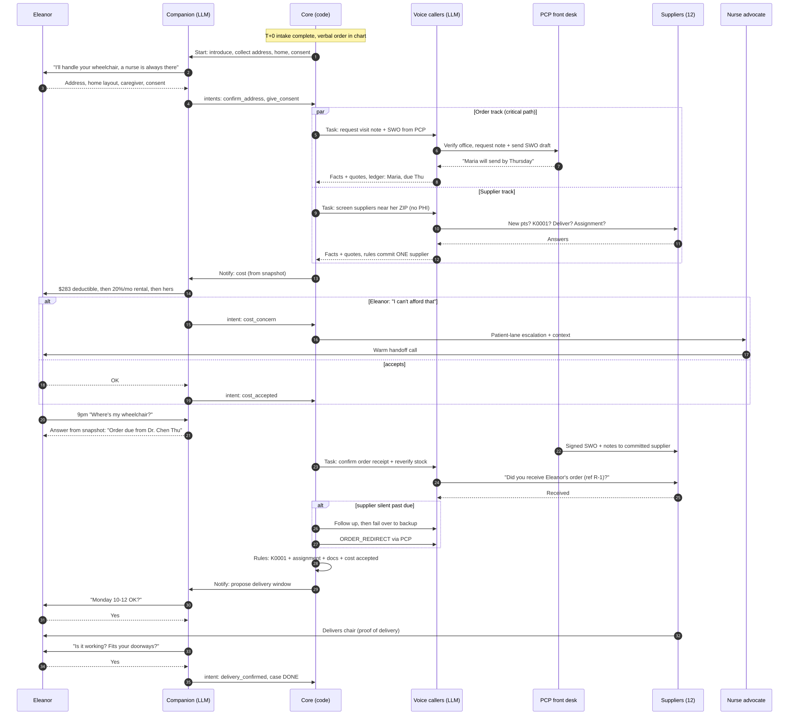

# User Journey — Eleanor's Wheelchair Case (v3)

How the system works Eleanor Martinez's case from completed intake to a delivered, correctly
billed standard manual wheelchair (K0001) — what Eleanor experiences, what happens behind the
scenes, and where a human comes back in.

Eleanor only ever talks to her **companion agent** (or, when needed, a nurse advocate).
Behind it, a **deterministic core** tracks who holds the ball on every open item, and
**outbound voice agents** call the PCP office and suppliers.

Source: [`user-journey.mmd`](user-journey.mmd)

**Starting point:** PCP visit 3 days ago (Dr. Sarah Chen, Sunrise Family Medicine, Chicago).
Verbal order in chart, written order not submitted. Original Medicare Part B, no Medigap.
No suppliers contacted. Eleanor's home address is unknown.

**Actors:** Eleanor (patient) · Companion agent · Core (code) · Outbound voice agents ·
Dr. Chen's front desk · 12 enrolled DME suppliers · Nurse advocate (only on escalation).

---

## Happy path (times are business-time, illustrative)

| # | When | Eleanor experiences (companion) | Behind the scenes (core + callers) | Ball with |
|---|---|---|---|---|
| 1 | T+0 | "Hi Eleanor, I'm your Mira Mace assistant. I'll handle getting your wheelchair — a nurse is always there if you need one." Collects address, home layout (doorways, stairs, floors), caregiver, best times, consent to act for her | Intents `confirm_address`, `give_consent` → events; patient profile written | Eleanor → us |
| 2 | T+0 | — | Caller rings PCP front desk: verifies office, references visit, requests visit note + sends pre-filled SWO. Ledger: `{Maria @ Sunrise, send note + signed order, due Thu}` | PCP |
| 3 | T+0 → T+4h | — | Callers screen suppliers nearest her ZIP, no PHI: new Medicare Part B pts? K0001 in stock? Deliver to her? Accept assignment every rental month? Extractor → facts with quotes | Suppliers |
| 4 | T+4h | — | Rules commit ONE supplier (lease, ref #); a second qualified one kept as backup, not held | us |
| 5 | T+4h | Plain cost explanation, numbers from the snapshot: first month(s) likely out of pocket until the $283 deductible is met, then 20% of the approved monthly rental for up to 13 months, then she owns it. "Does that work for you?" | Notify policy decides to tell her; grounding check passes; `cost_accepted` intent | Eleanor |
| 6 | anytime | Eleanor at 9pm: "Where's my wheelchair?" → "Dr. Chen's office promised to send the signed order by Thursday. I'll check with them then and let you know." | `ask_status` answered purely from the case snapshot | — |
| 7 | T+1–2d | — | Visit note arrives → extractor reads LCD criteria → rules: all present? | us |
| 8 | T+2d | "Good news — Dr. Chen signed your order." | Office faxes SWO + notes **to the committed supplier** | PCP → supplier |
| 9 | T+2–3d | — | Caller asks supplier: "Did you receive order #R?" Re-verifies stock within 24h of scheduling | Supplier |
| 10 | T+3d | "Lakeshore can bring it Monday 10–12. Does that suit you, or would your daughter prefer another time?" | Rules: K0001 match, assignment confirmed, docs supported, cost accepted → schedule | Eleanor |
| 11 | T+5d | Chair delivered; she signs proof of delivery | Supplier bills Medicare | Supplier |
| 12 | T+5d | "Is the chair working for you? Does it fit through your doorways?" | `POD_CONFIRMED` → `DONE` | — |

Eleanor is told only what changed, at most about once a day, in her preferred hours. She never chases anyone.

---

## Failure branches and how the system responds

| Failure | Detection | Automatic response | Eleanor hears | Escalate to human when |
|---|---|---|---|---|
| Supplier can't serve (not taking new pts / out of stock / out of area / no assignment) | Extracted facts fail eligibility rules | Disqualify, try next candidate | Nothing (not her problem) | All 12 exhausted |
| Supplier says yes, then goes silent | Ledger: owner = supplier, due + grace passed | Follow-up; if still silent, release lease, commit backup → `ORDER_REDIRECT` to PCP | Only if delivery date moves | Backup also fails |
| Order request falls in a hole ("we never got it") | PCP commitment overdue, or supplier says not received | Verify-first ("did you receive request #R?"), resend under same idempotency key, get a named owner; follow up at 24/48/72 business hours | "The doctor's office needs a nudge — I'm on it" | Still stalled after 72h |
| Visit note missing LCD criteria | Rules on extracted note | Request addendum naming the missing criterion | — | Still missing after one addendum, or clinical questions |
| Wrong order (code or description) | Rules on SWO: K0001 + required elements | Correction request → re-sign | — | Code drifts to K0002–K0007 (face-to-face + written order before delivery; K0005 prior auth) |
| Eleanor worried about cost: "I can't afford that" | Companion → `cost_concern` intent | Core pauses cost gate, opens patient-lane escalation | Empathetic reply, no new numbers, "a nurse will call you today" | Always (warm handoff) |
| Eleanor confused, distressed, or asks for a person | Companion → `needs_human` intent | Patient-lane escalation with conversation context | "I'm connecting you with a nurse now" | Always |
| Eleanor goes quiet | 3 attempts in her preferred hours unanswered | Try caregiver, plain re-send | — | Unreachable after attempts |
| Life events | Hospitalisation / switch to Medicare Advantage / declines | `PAUSED` / `COVERAGE_CHANGED` / `CANCELLED` (notify parties) | Acknowledged gently | Always notify advocate |

---

## Where a human comes back in

Only on the closed set of escalation triggers, in two lanes:

- **Case lane** (order, supplier, coding): the advocate sees the reason, what was tried, transcript snippets with evidence quotes, 2–3 typed options and a suggested action. Their answer becomes `HUMAN_RESOLVED`; only the blocked track waits.
- **Patient lane** (cost, distress, clinical, "a person please"): warm handoff — the nurse gets the full conversation and case snapshot and contacts Eleanor directly.

"No care advocate in the loop" means zero advocate minutes on a normal case, not zero humans and not zero care: Eleanor still consents, understands her cost, and confirms delivery — with a companion that is always available and never makes things up.

---

## Journey metrics

- Days from verbal order to delivery (primary).
- Advocate minutes per case (primary cost lever).
- % closed autonomously, with **false closes = 0** as a hard gate.
- Escalation precision and recall (case lane and patient lane).
- Companion: invented facts = 0, handoff recall, patient contacts answered, cost disputes.
